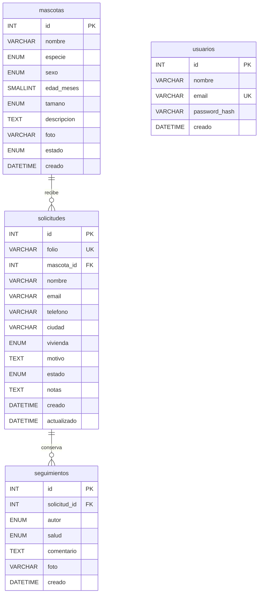

# Modelo de datos de ARGOS

Derivado de `database.sql` en el commit `4a2f4f74ea30919e9797eb6d7946cf3b58675b4f`. Se muestran campos principales y relaciones físicas. El diagrama no representa una base de producción inspeccionada.

Las cuatro tablas usan InnoDB y utf8mb4. Cada solicitud tiene una mascota y cada seguimiento pertenece a una solicitud. `usuarios` contiene las cuentas del refugio y no tiene claves foráneas hacia las otras tablas ni columna de rol. Los datos del adoptante se almacenan en la solicitud; una adopción es una solicitud con estado `aprobada`.

Ambas claves foráneas declaran `ON DELETE CASCADE`. Por ello, `borrar_mascota` elimina físicamente la mascota y sus solicitudes y seguimientos. Esto difiere de la baja lógica prevista en AR-16 y requiere decisión o corrección del equipo. No se ejecutó una eliminación para realizar esta revisión.

Las fotos se conservan como archivos; la base almacena sus rutas. La revisión del SQL no acredita por sí sola integridad en ejecución ni conservación de archivos tras un borrado.
